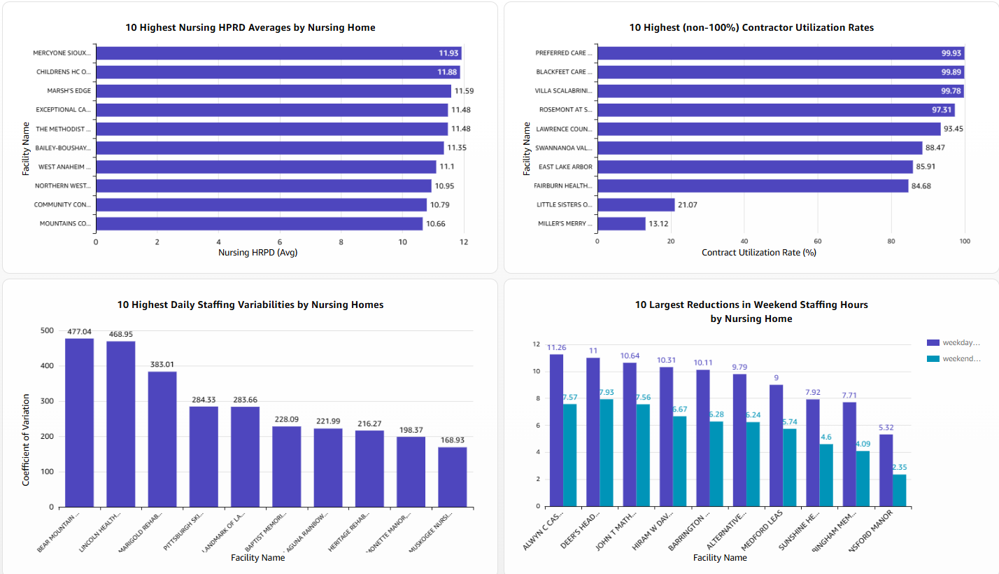

# Healthcare Nursing Home Staffing Analytics

An AWS-based data engineering project that transforms publicly available U.S. nursing home staffing datasets into an automated, layered analytics pipeline and an Amazon QuickSight dashboard.

## Project objective

Analyze nursing home staffing patterns using four metrics:

1. **Nursing Hours per Resident Day (HPRD)** — nursing hours relative to resident census.
2. **Contract Labor Utilization** — the share of staffing hours supplied by contract labor.
3. **Daily Staffing Variability** — variation in daily nursing HPRD relative to the facility average.
4. **Weekend vs. Weekday Staffing** — differences in nursing HPRD between weekend and weekday reporting days.

## Architecture

The pipeline ingests source CSV files from Google Drive using an AWS Glue Python Shell job and lands them in Amazon S3. AWS Glue then processes the data through Bronze (Parquet source data), Silver (cleaned dimensions and staffing facts), and Gold (analytics-ready staffing metrics). The AWS Glue Data Catalog and Amazon Athena expose the Gold datasets to an Amazon QuickSight dashboard using Direct Query. An AWS Glue Workflow orchestrates the pipeline daily.

For implementation details, see [Pipeline workflow](docs/pipeline-workflow.md). You can add your own architecture diagram to this section when you are ready.

## Technology stack

| Area | Technology |
| --- | --- |
| Source ingestion | Google Drive, AWS Glue Python Shell |
| Data lake | Amazon S3 |
| ETL | AWS Glue, Python |
| Metadata and SQL | AWS Glue Data Catalog, Amazon Athena |
| Orchestration | AWS Glue Workflow |
| Visualization | Amazon QuickSight (Athena Direct Query) |

## Source datasets

The ingestion job selects the latest available file for each of these five patterns:

- `PBJ_Daily_Nurse_Staffing_*.csv`
- `NH_DataCollectionIntervals_*.csv`
- `NH_ProviderInfo_*.csv`
- `NH_QualityMsr_MDS_*.csv`
- `NH_StateUSAverages_*.csv`

## Data layers

### Bronze — Source preservation and standardized storage

Five CSV source datasets are converted to Parquet in S3 Bronze run folders. A successful run writes a `_SUCCESS` marker. Athena/Glue Catalog tables expose the data for inspection.

### Silver — Cleaned, modeled data

- **Facility dimension:** provider attributes, location, ratings, and facility identifiers.
- **Reporting interval dimension:** quarterly and four-quarter reporting intervals.
- **Daily staffing fact:** resident census, nursing hours, employee hours, contract hours, and HPRD.

### Gold — Analysis-ready metrics

| Gold dataset | Analytical purpose |
| --- | --- |
| `nursing_hprd` | Compare nursing hours per resident day across facilities |
| `contract_labor_utilization` | Compare contract labor utilization |
| `daily_staffing_variability` | Examine variability in daily staffing levels |
| `weekend_weekday_staffing` | Compare weekend and weekday nursing HPRD |

See [Data model](docs/data-model.md) for additional details.

## Orchestration and processing

An AWS Glue Workflow (`healthcare_staffing_pipeline`) is scheduled **daily at 06:00 UTC**, with a maximum of one concurrent run. Source-change and no-change scenarios have been tested. The pipeline uses a recorded processing baseline (`20261110T153545Z`) to support change-aware execution.

See [Pipeline workflow](docs/pipeline-workflow.md) for the implementation overview.

## Validation highlights

Completed checks include:

- Bronze dataset conversion and nonempty output verification.
- Provider information validation across **14,814 facilities**.
- Daily staffing fact validation: **0 nursing-hour mismatches**, **0 invalid contract rates**, and **0 invalid-census-with-HPRD records** in the reported checks.
- Successful runs for both changed-source and unchanged-source scenarios.
- Published QuickSight dashboard confirmed to load all four charts.

See [Data quality](docs/data-quality.md) for additional recorded checks and limitations.

## Dashboard

The published **Healthcare Nursing Home Staffing Dashboard** includes:

1. **Top 10 Nursing Homes by Average Nursing HPRD** — horizontal bar chart.
2. **Top 10 Nursing Homes by Contract Labor Utilization (Under 100%)** — horizontal bar chart.
3. **Top 10 Nursing Homes by Daily Staffing Variability** — vertical column chart.
4. **Top 10 Nursing Homes with the Largest Weekend Staffing Reductions** — grouped vertical bar chart.

The QuickSight datasets use **Athena Direct Query** rather than SPICE imports. See [Dashboard notes](docs/dashboard.md).

<!-- Add a screenshot after verifying it contains no private information. -->
<!--  -->

## Engineering decisions

- **Layered data lake:** Separates source-oriented storage from reusable analytical models.
- **Parquet storage:** Makes structured datasets easier to query and process in AWS analytics services.
- **Daily orchestration:** Automates ingestion and downstream transformation stages.
- **Change-aware behavior:** Supports reruns when source files have not changed.
- **Direct Query:** Allows QuickSight to query Athena-backed Gold datasets without a separate SPICE refresh schedule.

## Limitations and next steps

- The dashboard currently reflects **one reporting quarter**, so a time-series staffing trend chart would not yet be meaningful.
- Some unusually large staffing variability coefficients require further investigation before interpreting them as real-world anomalies.
- The contract-utilization chart excludes individual reporting values at or above 100%; this is not necessarily equivalent to excluding facilities whose overall utilization is 100%.
- Automated failure notifications, recovery testing, and operational monitoring remain future enhancements.
- Source code and SQL validation queries should be added to `glue_jobs/` and `sql/` from the actual deployed implementation. **No production code is reproduced or fabricated in this starter repository.**

## Security and reproducibility

Do not commit AWS credentials, IAM secrets, Google Drive credentials, private source documents, or identifying resident-level data. Before adding deployable scripts, replace environment-specific identifiers with configuration parameters and document the IAM permissions they require.
